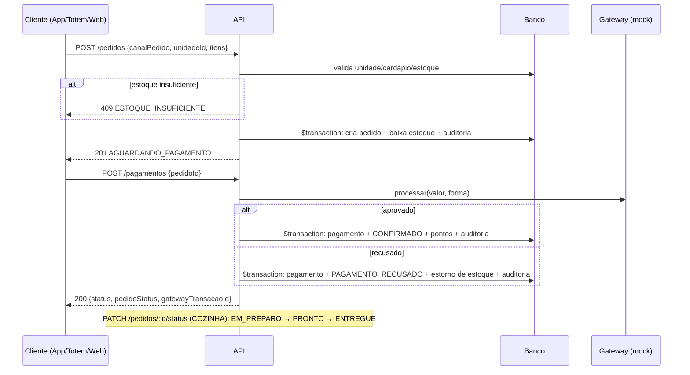

# API Raízes do Nordeste

API REST da rede de lanchonetes **Raízes do Nordeste**, feita para o Projeto Multidisciplinar UNINTER (Trilha Back-End).

Ela cobre pedidos multicanal (APP, TOTEM, BALCAO, PICKUP, WEB), estoque por unidade, pagamento por gateway **mock**, programa de fidelidade com consentimento LGPD e trilha de auditoria.

**Fluxo crítico entregue (Fluxo A):** Pedido → Pagamento mock → Atualização de status.

| Evidência | Onde |
|---|---|
| Repositório | `https://github.com/guilhermeholm/raizes-nordeste-trab` |
| Swagger UI (local) | http://localhost:3000/api-docs |
| OpenAPI JSON (local) | http://localhost:3000/api-docs.json |
| Coleção Postman | [`postman/raizes-do-nordeste.postman_collection.json`](postman/raizes-do-nordeste.postman_collection.json) |

---

## Início rápido

```bash
npm install            # instala as dependências
cp .env.example .env   # cria o arquivo de configuração (os valores padrão já funcionam)
npm run setup          # gera o Prisma Client, cria o banco SQLite e popula com dados de exemplo
npm run dev            # sobe a API em http://localhost:3000
```

Depois, abra http://localhost:3000/api-docs para testar pelo Swagger. Os detalhes de cada passo estão nas seções 1 a 5.

---

## Sobre o projeto

### Contexto

A Raízes do Nordeste é uma franquia de lanchonetes de comida nordestina em expansão nacional. A operação tem três características que moldam o back-end:

- **Várias unidades**, cada uma com cardápio, estoque e equipe próprios. Uma unidade com cozinha compacta, por exemplo, não vende pratos quentes.
- **Vários canais de venda**: aplicativo, totem de autoatendimento, balcão, retirada (pick-up) e site. O canal de origem de cada pedido é registrado para que a matriz acompanhe o desempenho de cada um.
- **Gestão centralizada pela matriz**, que precisa de rastreabilidade sobre vendas, estoque e ações sensíveis.

Somam-se a isso um programa de fidelidade, que exige consentimento conforme a LGPD, e a integração com um gateway de pagamento externo, simulado (mock) neste projeto.

### Objetivo

Entregar uma API REST que funcione localmente, com persistência real em banco, e que demonstre de ponta a ponta o fluxo mais crítico do negócio:

1. O cliente monta o pedido em um dos canais.
2. A API valida o cardápio e o estoque da unidade e reserva os itens.
3. O pagamento é enviado ao gateway.
4. Conforme a resposta, o pedido é confirmado (e o cliente ganha pontos) ou recusado (e os itens voltam ao estoque).
5. A cozinha acompanha o pedido até a entrega.

### Atores e perfis

| Perfil | Papel no sistema |
|---|---|
| CLIENTE | Faz pedidos pelos canais digitais, paga, acompanha os próprios pedidos e usa a fidelidade |
| ATENDENTE | Registra pedidos no balcão (inclusive em nome de clientes cadastrados) e consulta o estoque |
| COZINHA | Avança o status dos pedidos: em preparo, pronto, entregue |
| GERENTE | Gerencia produtos e estoque e consulta usuários e pedidos |
| ADMIN | Acesso total, inclusive à trilha de auditoria e ao cadastro de funcionários |
| Gateway (sistema externo) | Aprova ou recusa pagamentos. Simulado pelo `PaymentGatewayMock`. |

---

## 1. Requisitos

| Item | Versão |
|---|---|
| Node.js | 20 LTS ou superior (testado com 20.11 e 22.22) |
| npm | 10+ |
| Banco de dados | SQLite 3 (arquivo local, sem instalação: o Prisma cria o arquivo) |
| ORM | Prisma 5 |
| Linguagem | TypeScript |
| Principais libs | Express 4, Zod 4, jsonwebtoken, bcryptjs, helmet, express-rate-limit, winston, swagger-ui-express |

> **Por que SQLite?** Para que qualquer avaliador rode o projeto sem Docker nem servidor de banco. O Prisma abstrai o SGBD: para usar PostgreSQL basta trocar o `provider` em `prisma/schema.prisma` e a `DATABASE_URL`.

## 2. Variáveis de ambiente

Copie o modelo e ajuste se necessário. Os valores padrão já funcionam localmente.

```bash
cp .env.example .env
```

| Variável | Descrição | Padrão |
|---|---|---|
| `PORT` | Porta HTTP | `3000` |
| `NODE_ENV` | `development` \| `production` \| `test` | `development` |
| `DATABASE_URL` | Caminho do SQLite (relativo a `prisma/`) | `file:./dev.db` |
| `JWT_SECRET` | Chave de assinatura do JWT (HS256) | — |
| `JWT_EXPIRES_IN` | Expiração do token em segundos | `3600` |
| `DATA_ENCRYPTION_KEY` | Chave AES-256-GCM para dados pessoais em repouso (CPF) | — |
| `PAGAMENTO_TAXA_APROVACAO` | Taxa de aprovação do mock quando não há `cenario` (0 a 1) | `0.8` |
| `LGPD_DATA_RETENTION_DAYS` | Prazo de retenção documentado | `365` |
| `LOG_LEVEL` | Nível de log do Winston | `info` |

## 3. Instalação, banco e seed

```bash
npm install
npm run setup     # prisma generate + db push (cria as tabelas) + seed
```

Comandos individuais: `npm run prisma:generate`, `npm run prisma:push`, `npm run prisma:seed` (recria os dados de demonstração do zero) e `npm run prisma:studio` (abre um visualizador do banco).

### Usuários do seed

| E-mail | Senha | Perfil |
|---|---|---|
| `admin@raizes.com` | `Admin@123` | ADMIN |
| `gerente@raizes.com` | `Gerente@123` | GERENTE |
| `atendente@raizes.com` | `Atend@123` | ATENDENTE |
| `cozinha@raizes.com` | `Cozinha@123` | COZINHA |
| `maria@email.com` | `Cliente@123` | CLIENTE |
| `joao@email.com` | `Cliente@123` | CLIENTE |

O seed também cria:

- 3 unidades: Recife Centro, Boa Viagem e Fortaleza. Fortaleza tem cozinha compacta, por isso os pratos quentes ficam indisponíveis lá.
- 10 produtos típicos, com estoque em cada unidade. O Bolo de Macaxeira começa com estoque baixo na unidade 1.
- O programa de fidelidade dos dois clientes, com consentimento registrado.

## 4. Executar a API

```bash
npm run dev       # desenvolvimento (hot reload)
# ou
npm run build && npm start
```

- Healthcheck: http://localhost:3000/health
- **Swagger:** http://localhost:3000/api-docs. Faça login em `POST /auth/login`, copie o `accessToken` e clique em **Authorize**.

## 5. Testes

### 5.0 Testes automatizados (Jest)

```bash
npm test                 # testes unitários e de integração (54 testes)
npm run test:coverage    # o mesmo, com relatório de cobertura
```

Os testes usam um banco SQLite separado e não alteram o `dev.db`.

### 5.1 Coleção Postman

1. Rode `npm run prisma:seed` para partir do estado inicial e depois `npm run dev`.
2. No Postman: **Import** → `postman/raizes-do-nordeste.postman_collection.json`.
3. A variável `BASE_URL` já vem como `http://localhost:3000`.
4. Execute a coleção inteira pelo **Collection Runner**, ou as pastas nesta ordem:
   - **0. Setup**: logins de Admin, Gerente e Cozinha. Os tokens são salvos automaticamente.
   - **1. Plano de Testes (T01–T12)**: o T01 salva `TOKEN_CLIENTE` e o T08 salva `PEDIDO_ID`.
   - **2. Cenários Extras**: erros 404/409/422, pagamento recusado, estoque, LGPD e fidelidade.

Pela linha de comando: `npx newman run postman/raizes-do-nordeste.postman_collection.json` (33 requisições e 55 asserções).

### 5.2 Plano de testes

| ID | Tipo | Cenário | Endpoint | Pré-condição | Entrada | Esperado | Evidência (Postman) |
|---|---|---|---|---|---|---|---|
| T01 | + | Login de cliente | `POST /auth/login` | Seed aplicado | `{email, senha}` válidos | 200 + `accessToken`, perfil CLIENTE | 1. Plano/T01 |
| T02 | − | Senha incorreta | `POST /auth/login` | Usuário existe | senha errada | 401 `CREDENCIAIS_INVALIDAS` | 1. Plano/T02 |
| T03 | − | Sem token | `GET /fidelidade/saldo` | — | sem `Authorization` | 401 `TOKEN_AUSENTE` | 1. Plano/T03 |
| T04 | − | Perfil sem permissão | `POST /produtos` | Token CLIENTE | produto | 403 `ACESSO_NEGADO` | 1. Plano/T04 |
| T05 | + | Cardápio da unidade | `GET /produtos/unidade/1` | Unidade 1 existe | — | 200 + lista com `estoqueDisponivel` | 1. Plano/T05 |
| T06 | − | Campo obrigatório ausente | `POST /pedidos` | Token CLIENTE | `{unidadeId:1}` | 422 `VALIDACAO_FALHOU` (`canalPedido`, `itens`) | 1. Plano/T06 |
| T07 | − | Estoque insuficiente | `POST /pedidos` | Produto 1 com 50 un. | quantidade 999 | 409 `ESTOQUE_INSUFICIENTE` | 1. Plano/T07 |
| T08 | + | Criar pedido | `POST /pedidos` | Token CLIENTE | `canalPedido`, itens | 201, `AGUARDANDO_PAGAMENTO`, total 60,30 | 1. Plano/T08 |
| T09 | + | Pagamento mock aprovado | `POST /pagamentos` | Pedido do T08 | `{pedidoId, cenario:"APROVAR"}` | 200 `APROVADO`, pedido `CONFIRMADO` | 1. Plano/T09 |
| T10 | + | Pontos de fidelidade | `GET /fidelidade/saldo` | T09 aprovado | — | 200, saldo ≥ 60 | 1. Plano/T10 |
| T11 | + | Cozinha atualiza status | `PATCH /pedidos/:id/status` | Token COZINHA | `{status:"EM_PREPARO"}` | 200 CONFIRMADO → EM_PREPARO | 1. Plano/T11 |
| T12 | + | Auditoria | `GET /auditoria` | T11 executado | `?recurso=pedido&recursoId=` | 200 + log `STATUS_PEDIDO_ALTERADO` (perfil COZINHA) | 1. Plano/T12 |
| T13 | − | Formato inválido | `POST /pedidos` | Token CLIENTE | quantidade −2, canal `FAX` | 422 | 2. Extras |
| T14 | − | Produto inexistente | `POST /pedidos` | Token CLIENTE | `produtoId: 9999` | 404 `PRODUTO_NAO_ENCONTRADO` | 2. Extras |
| T15 | − | Pagamento recusado | `POST /pagamentos` | Pedido novo | `cenario:"RECUSAR"` | 200 `RECUSADO`, pedido `PAGAMENTO_RECUSADO`, estoque estornado | 2. Extras |
| T16 | − | Pagamento duplicado | `POST /pagamentos` | Pedido já pago | mesmo `pedidoId` | 409 `PAGAMENTO_JA_PROCESSADO` | 2. Extras |
| T17 | − | Transição inválida | `PATCH /pedidos/:id/status` | Pedido EM_PREPARO | `ENTREGUE` | 409 `TRANSICAO_STATUS_INVALIDA` | 2. Extras |

---

## 6. Arquitetura

O projeto usa uma Clean Architecture simplificada, em 4 camadas:

```
src/
├── domain/            # Regras puras: enums, máquina de estados do pedido, erros de domínio
├── application/       # Casos de uso (services) + DTOs/validação (Zod)
├── infrastructure/    # Prisma, gateway de pagamento mock, logger/auditoria, criptografia
├── api/               # Rotas, controllers, middlewares (auth, roles, validação, erros), Swagger
├── config/env.ts      # Variáveis de ambiente validadas com Zod (fail-fast)
├── app.ts             # Montagem do Express
└── server.ts          # Bootstrap + graceful shutdown
prisma/                # schema.prisma (modelo de dados) + seed.ts
postman/               # Coleção de testes
```

- **API**: só traduz HTTP ↔ caso de uso. Não conhece regras de negócio nem o banco.
- **Application**: orquestra o fluxo (ex.: `PedidoService.criar` valida, calcula, baixa o estoque e audita na mesma transação).
- **Infrastructure**: detalhes técnicos substituíveis. O `PaymentGatewayMock` segue o contrato `SolicitacaoPagamento` → `RespostaGateway`; para trocá-lo por um gateway real, falta extrair uma interface (ver seção 9.1).

### Fluxo crítico



### Regras de negócio implementadas

- **Multicanal:** `canalPedido` é obrigatório (enum) e é registrado no pedido. A listagem filtra por canal (`GET /pedidos?canalPedido=TOTEM`).
- **Preço do servidor:** o total é calculado com o preço do banco, nunca com valores enviados pelo cliente.
- **Estoque atômico:** a baixa usa `UPDATE ... WHERE quantidade >= N` dentro de `$transaction`. Assim, pedidos simultâneos não vendem acima do saldo.
- **Disponibilidade por unidade:** um produto inexistente retorna 404. Um produto fora do cardápio da unidade, ou indisponível nela, retorna 409 `PRODUTO_INDISPONIVEL`.
- **Máquina de estados do pedido:**
  - `AGUARDANDO_PAGAMENTO` → `CANCELADO`
  - `CONFIRMADO` → `EM_PREPARO` ou `CANCELADO`
  - `EM_PREPARO` → `PRONTO` → `ENTREGUE`
  - `PAGAMENTO_RECUSADO` → `CANCELADO`

  `CONFIRMADO` e `PAGAMENTO_RECUSADO` só são atingidos pelo pagamento. Um cancelamento devolve os itens ao estoque.
- **Pagamento mock:**
  - Idempotente: um pagamento por pedido, com `UNIQUE(pedidoId)`, e retorno 409 em caso de repetição.
  - O gateway é chamado fora da transação, como numa integração real.
  - Na recusa, o estoque é estornado.
  - O campo opcional `cenario` (`APROVAR`/`RECUSAR`) torna os testes determinísticos. Sem ele, o mock aprova cerca de 80% dos pagamentos e recusa valores acima de R$ 1.000.
- **Fidelidade:**
  - Acúmulo de 1 ponto por real, automático na aprovação e idempotente por pedido.
  - Só ocorre com consentimento `FIDELIZACAO`.
  - Resgate com débito condicional (o saldo nunca fica negativo), à razão de 10 pontos = R$ 1,00 de desconto simulado.
- **Promoções:** a tabela `promocoes` existe e o seed cria a campanha "São João" (percentual, por vigência e opcionalmente por unidade). A aplicação automática do desconto ficou como **proposta**:
  1. Na criação do pedido, buscar as promoções ativas e vigentes da unidade (ou globais).
  2. Aplicar o maior desconto elegível sobre os itens.
  3. Registrar o desconto no pedido.

## 7. Endpoints

O contrato completo, com exemplos, está no Swagger (`/api-docs`) e em [`04-api-endpoints.md`](04-api-endpoints.md).

| Recurso | Método | Rota | Perfis |
|---|---|---|---|
| Auth | POST | `/auth/login` | Público |
| Auth | POST | `/auth/refresh` | Autenticado |
| Usuários | POST | `/usuarios` | Público (CLIENTE) / ADMIN (outros perfis) |
| Usuários | GET | `/usuarios` | ADMIN, GERENTE |
| Usuários | GET | `/usuarios/:id` | ADMIN, GERENTE, o próprio |
| Usuários | DELETE | `/usuarios/:id` | ADMIN, o próprio (anonimização LGPD) |
| Unidades | GET | `/unidades`, `/unidades/:id` | Público |
| Produtos | GET | `/produtos`, `/produtos/unidade/:unidadeId` | Público |
| Produtos | POST / PUT | `/produtos`, `/produtos/:id` | ADMIN, GERENTE |
| Estoque | GET | `/estoque/unidade/:unidadeId` | ADMIN, GERENTE, ATENDENTE |
| Estoque | POST | `/estoque/movimentacao` | ADMIN, GERENTE |
| **Pedidos** | POST | `/pedidos` | CLIENTE, ATENDENTE |
| Pedidos | GET | `/pedidos`, `/pedidos/:id` | CLIENTE (os seus) / funcionários |
| **Pedidos** | PATCH | `/pedidos/:id/status` | COZINHA, GERENTE, ADMIN |
| **Pagamentos** | POST | `/pagamentos` | CLIENTE, ATENDENTE |
| Pagamentos | GET | `/pagamentos/pedido/:pedidoId` | Dono / funcionários |
| Fidelidade | GET | `/fidelidade/saldo`, `/fidelidade/historico` | CLIENTE |
| Fidelidade | POST | `/fidelidade/resgatar` | CLIENTE |
| Fidelidade | PUT | `/fidelidade/consentimento` | CLIENTE |
| Fidelidade | POST | `/fidelidade/acumular` | ADMIN (reprocessamento) |
| Auditoria | GET | `/auditoria` | ADMIN |

### Padrão de erro (todas as falhas)

```json
{
  "error": "ESTOQUE_INSUFICIENTE",
  "message": "Não há quantidade suficiente para um ou mais itens.",
  "details": [{ "field": "itens[0].quantidade", "issue": "Disponível: 50" }],
  "timestamp": "2026-10-08T12:00:00.000Z",
  "path": "/pedidos",
  "requestId": "6f1c2a0e-..."
}
```

Status usados:

| Status | Quando |
|---|---|
| 400 | JSON malformado |
| 401 | Não autenticado |
| 403 | Perfil sem permissão |
| 404 | Recurso não encontrado |
| 409 | Regra de negócio ou conflito |
| 422 | Validação |
| 429 | Rate limit |
| 500 | Erro interno |

## 8. Segurança e LGPD

| Controle | Implementação |
|---|---|
| Senhas | `bcryptjs` (custo 10). O hash nunca é retornado pela API. |
| Autenticação | JWT HS256 com `sub` e `perfil`, expira em 1 h, renovável em `/auth/refresh` |
| Autorização | `roleMiddleware` por perfil, mais checagem de propriedade (o cliente só vê os próprios pedidos e pagamentos) |
| Força bruta | 10 tentativas de login a cada 15 min por IP, mais um rate limit global |
| Headers | `helmet` |
| Validação | Zod em body, query e params (fail-fast). Retorna 422 com a lista de campos. |
| Minimização | Cadastro exige só nome, e-mail e senha. CPF e telefone são opcionais. |
| CPF | Criptografado em repouso (AES-256-GCM) e exibido sempre mascarado (`***.***.789-01`) |
| Consentimento | Tabela `consentimentos_lgpd`, por finalidade (`FIDELIZACAO`, `MARKETING`), com IP, data e revogação (`PUT /fidelidade/consentimento`) |
| Eliminação | `DELETE /usuarios/:id` anonimiza nome, e-mail, CPF e telefone, revoga os consentimentos e desativa a conta. O ID é mantido para preservar o histórico fiscal dos pedidos. |
| Auditoria | `audit_logs` registra `acao`, `recurso`, `usuarioId`, `ipOrigem`, `requestId` e um snapshot do que mudou. A gravação acontece na mesma transação da operação. |
| Rastreabilidade | Cada requisição recebe um `X-Request-Id` (gerado ou propagado), presente nos logs, nos erros e na auditoria |

**Ações auditadas:**

- `USUARIO_CRIADO`, `USUARIO_ANONIMIZADO` e `DADOS_PESSOAIS_ACESSADOS`
- `PRODUTO_CRIADO`, `PRODUTO_ATUALIZADO` e `ESTOQUE_MOVIMENTADO`
- `PEDIDO_CRIADO`, `STATUS_PEDIDO_ALTERADO` e `PEDIDO_CANCELADO`
- `PAGAMENTO_APROVADO` e `PAGAMENTO_RECUSADO`
- `PONTOS_ACUMULADOS`, `PONTOS_RESGATADOS` e `CONSENTIMENTO_CONCEDIDO`/`CONSENTIMENTO_REVOGADO`

## 9. Implementado × proposto

| Funcionalidade | Situação |
|---|---|
| Auth JWT + perfis, cadastro com consentimento | Implementado |
| Unidades e cardápio por unidade | Implementado |
| Produtos (CRUD sem exclusão física; desativação via `ativo`) | Implementado |
| Estoque por unidade (entrada/saída/ajuste, alerta de estoque baixo) | Implementado |
| Pedidos multicanal + máquina de estados + cancelamento com estorno | Implementado |
| Pagamento mock (aprovado/recusado, idempotente) | Implementado |
| Fidelidade (acúmulo, resgate, histórico, consentimento) | Implementado |
| LGPD (hash, criptografia de CPF, mascaramento, anonimização) | Implementado |
| Auditoria + logs estruturados (Winston) | Implementado |
| Swagger/OpenAPI + coleção Postman | Implementado |
| Promoções aplicadas automaticamente no pedido | Modelado e documentado (proposta) |
| Relatórios consolidados da matriz | Proposta (o filtro `/pedidos?unidadeId=&canalPedido=` já serve de base) |
| Expurgo automático por prazo de retenção | Proposta (job agendado usando `LGPD_DATA_RETENTION_DAYS`) |
| Deploy em nuvem | Fora do escopo (avaliação local) |

### 9.1 Código declarado e não utilizado

Alguns tipos, constantes e estruturas foram criados para documentar o domínio ou preparar evoluções futuras, mas nenhuma parte do código os utiliza.

**Tipos e constantes de domínio sem uso** (`src/domain/enums/index.ts`):

| Símbolo | Situação |
|---|---|
| `CanalPedido`, `FormaPagamento`, `StatusPagamento`, `TipoMovimentacaoEstoque`, `TipoMovimentacaoFidelidade` | Tipos declarados e nunca referenciados. Como o SQLite não tem `enum` nativo, as colunas são `String` no Prisma, e os services usam literais (`'APROVADO'`, `'ACUMULO'` etc.) em vez desses tipos. Só `PerfilUsuario` e `StatusPedido` são usados de fato. |
| `STATUS_PAGAMENTO` | Lista nunca usada. Dos quatro valores, só `APROVADO` e `RECUSADO` são gravados. `PENDENTE` existe só como `@default` da coluna `pagamentos.status`, mas o registro é sempre criado já com o resultado do gateway. `ERRO` nunca é produzido, porque o mock não simula falha de comunicação. |
| `TIPOS_MOV_FIDELIDADE` | Lista nunca usada. Os tipos `ACUMULO`/`RESGATE` são gravados como texto direto pelo `FidelidadeService`. |

**Gateway de pagamento sem interface abstrata:** `SolicitacaoPagamento` e `RespostaGateway` (`src/infrastructure/payment/PaymentGatewayMock.ts`) descrevem o contrato do gateway, mas o `PagamentoService` depende diretamente da classe concreta `PaymentGatewayMock`. Não existe uma interface `PaymentGateway` que um gateway real pudesse implementar. A troca exigiria extrair essa interface e alterar o tipo injetado no construtor do `PagamentoService`.

**Exports desnecessários:** `AuditEntry`, `CenarioPagamento`, `SolicitacaoPagamento`, `RespostaGateway`, `toUsuarioResponse` e `toPedidoResponse` são exportados, mas usados apenas dentro do próprio arquivo.

**Estruturas sem código associado:**

- O modelo `Promocao` (tabela `promocoes`) é criado e populado pelo seed, mas não tem service, rota nem regra que o leia (ver proposta na seção 6).
- A variável `LGPD_DATA_RETENTION_DAYS` é validada em `src/config/env.ts`, mas nenhum código a lê: o expurgo automático é apenas proposta.

## 10. Conceitos técnicos aplicados

Esta seção explica os principais conceitos por trás das decisões do projeto e onde cada um aparece no código.

### 10.1 Condição de corrida (*race condition*)

Uma condição de corrida acontece quando duas operações concorrentes leem o mesmo estado e agem com base nele, e o resultado final depende da ordem em que executam. O padrão mais comum é o "verificar e depois agir" (*check-then-act*): ler um valor, decidir no código e então gravar.

**Exemplo no projeto:** o estoque tem 1 unidade e chegam dois pedidos ao mesmo tempo. Se a API lesse o estoque, comparasse no código e depois fizesse `decrement`, os dois pedidos veriam "1 disponível", ambos passariam na verificação e o estoque terminaria em −1. Esse é o problema da **atualização perdida** (*lost update*): um item vendido sem existir.

**Solução adotada:** a verificação e a escrita acontecem numa única operação atômica no banco, com uma atualização condicional (`PedidoService.criar`):

```ts
tx.estoque.updateMany({
  where: { produtoId, unidadeId, quantidade: { gte: quantidadePedida } },
  data: { quantidade: { decrement: quantidadePedida } },
});
// count === 0 → outro pedido levou o item antes → 409 ESTOQUE_INSUFICIENTE
```

A mesma técnica, conhecida como **controle de concorrência otimista**, protege a transição de status do pedido (`where: { status: statusAnterior }`), o débito de pontos de fidelidade (`saldoPontos >= pontos`) e a movimentação de estoque.

### 10.2 Transações e atomicidade (ACID)

Uma transação agrupa várias operações para que **todas aconteçam ou nenhuma aconteça** (atomicidade). Criar um pedido envolve gravar o pedido e os itens, baixar o estoque, registrar a movimentação e gravar a auditoria. Se qualquer etapa falhar, o `prisma.$transaction` desfaz tudo (*rollback*), e o banco nunca fica com um pedido sem baixa de estoque, ou o contrário.

**Por que o gateway de pagamento fica fora da transação:** uma chamada externa é lenta e imprevisível (rede, timeout). Dentro de uma transação, ela manteria o banco bloqueado durante a espera, o que prejudica todos os outros pedidos em horário de pico. Além disso, um rollback do banco não desfaz uma cobrança externa. Por isso a API consulta o gateway primeiro e só depois grava o resultado numa transação curta.

### 10.3 Idempotência

Uma operação é idempotente quando executá-la várias vezes produz o mesmo efeito que executá-la uma vez. Isso é essencial em pagamentos: se o cliente clicar duas vezes ou a rede reenviar a requisição, ele não pode ser cobrado duas vezes.

**No projeto:**
- a tabela `pagamentos` tem `UNIQUE(pedidoId)`, e o pedido só muda de status se ainda estiver `AGUARDANDO_PAGAMENTO`. Uma segunda tentativa recebe **409 `PAGAMENTO_JA_PROCESSADO`**;
- o acúmulo de pontos verifica se aquele pedido já gerou pontos, o que impede creditar duas vezes.

**Diferença em relação à condição de corrida:** idempotência trata a *repetição da mesma requisição*. A condição de corrida trata *requisições diferentes e legítimas* disputando o mesmo recurso. As duas se relacionam porque uma corrida pode quebrar a garantia de idempotência quando a checagem de duplicidade é feita só no código.

**Limitação conhecida:** em duas requisições simultâneas de pagamento, o banco impede o registro duplicado, mas o gateway mock é chamado duas vezes. Com um gateway real, o correto é enviar uma **chave de idempotência** (por exemplo, o `pedidoId`) para o próprio gateway descartar a repetição.

### 10.4 Máquina de estados

O status do pedido segue uma máquina de estados finita: cada status define explicitamente para quais outros pode avançar (`TRANSICOES_STATUS_PEDIDO` em `src/domain/enums/index.ts`). Transições fora da tabela retornam **409 `TRANSICAO_STATUS_INVALIDA`**.

`CONFIRMADO` e `PAGAMENTO_RECUSADO` não aparecem como destinos manuais: só o resultado do pagamento leva o pedido até eles, o que impede um funcionário de "confirmar" um pedido não pago.

### 10.5 Valores históricos ("fotografia" dos dados)

O `ItemPedido` grava `precoUnitario` e `subtotal` no momento da compra, em vez de consultar o preço atual do produto. Se o gerente mudar o preço depois, os pedidos antigos continuam com o valor efetivamente cobrado. O total é sempre calculado no servidor com o preço do banco, nunca com valores enviados pelo cliente, o que impede a **adulteração de parâmetros** (*parameter tampering*).

### 10.6 Validação em camadas: 422 × 409

- **422 (Unprocessable Content):** o dado é inválido em qualquer situação (quantidade negativa, e-mail malformado, `canalPedido` inexistente). A validação é feita pelo **Zod no DTO**, antes de chegar ao service. Como não depende do banco, falha cedo e de forma barata (*fail-fast*).
- **409 (Conflict):** o dado é válido, mas conflita com o estado atual do sistema (estoque insuficiente, pedido já pago, transição de status inválida). Só pode ser verificado no **service**, que consulta o banco.

### 10.7 Autenticação, autorização e IDOR/BOLA

- **Autenticação** responde "quem é você?". É feita com JWT assinado (HS256), que carrega o ID e o perfil do usuário.
- **Autorização** responde "o que você pode fazer?". Tem dois níveis:
  - **por perfil (RBAC):** o `roleMiddleware` bloqueia, por exemplo, um CLIENTE tentando criar produtos (403);
  - **por objeto:** o service verifica se o recurso pertence ao usuário (`pedido.clienteId !== ator.id`).

Sem o segundo nível, um cliente autenticado poderia trocar o ID na URL e consultar ou pagar o pedido de outra pessoa. Essa falha se chama **IDOR** (*Insecure Direct Object Reference*) ou **BOLA** (*Broken Object Level Authorization*) e é o primeiro item do OWASP API Security Top 10.

### 10.8 Hash × criptografia

- **Hash (bcrypt) para senhas:** função de mão única. A senha original não pode ser recuperada, apenas comparada no login. O bcrypt é propositalmente lento e usa *salt*, o que dificulta ataques de força bruta e de tabelas pré-calculadas.
- **Criptografia (AES-256-GCM) para o CPF:** função reversível com chave. O CPF precisa ser recuperado (para nota fiscal ou para exibição mascarada), então um hash não serviria. O modo GCM também detecta adulteração do dado cifrado.

**Como o AES-256-GCM foi aplicado (`src/infrastructure/security/crypto.ts`):**

- **AES** é a cifra simétrica padronizada pelo NIST na FIPS 197. A versão de 256 bits usa uma chave de 32 bytes. No projeto, essa chave é derivada da variável `DATA_ENCRYPTION_KEY` com SHA-256 (NATIONAL INSTITUTE OF STANDARDS AND TECHNOLOGY, 2023).
- **GCM** (*Galois/Counter Mode*) é um modo de **criptografia autenticada**: além de cifrar, ele gera uma *tag* de autenticação. Na decifragem, se o dado ou a *tag* tiverem sido alterados, a operação falha (DWORKIN, 2007; MCGREW, 2008). No Node.js, a *tag* é obtida com `cipher.getAuthTag()` depois de `cipher.final()` e informada na decifragem com `decipher.setAuthTag()`. Se o dado tiver sido adulterado, `decipher.final()` lança um erro (NODE.JS, s.d.).
- **IV (vetor de inicialização) de 12 bytes (96 bits)**, gerado aleatoriamente a cada cifragem com `randomBytes(12)`. O tamanho de 96 bits é o recomendado para o GCM, e o IV nunca deve se repetir com a mesma chave (DWORKIN, 2007, seção 8; MCGREW, 2008).
- **Formato armazenado:** `iv.tag.dado`, cada parte em Base64. Assim, o banco guarda tudo o que é necessário para decifrar, exceto a chave.
- **Por que GCM:** o OWASP recomenda o AES com chave de pelo menos 128 bits (idealmente 256) e indica os modos autenticados, com GCM e CCM em primeiro lugar (OWASP, s.d.).
- **Limitação conhecida:** o OWASP recomenda gerar as chaves com um gerador criptograficamente seguro e guardá-las separadas dos dados, de preferência em um cofre de chaves. Neste projeto acadêmico, a chave fica no `.env` e é derivada por SHA-256 de um texto. Em produção, o recomendado seria uma chave aleatória de 32 bytes guardada em um serviço de gerenciamento de chaves (KMS), com rotação periódica.

### 10.9 LGPD aplicada ao back-end

| Princípio / direito | Aplicação no projeto |
|---|---|
| Finalidade e consentimento (arts. 6º, 7º e 8º) | Consentimento registrado por finalidade (`FIDELIZACAO`, `MARKETING`), com data, IP e possibilidade de revogação |
| Necessidade / minimização (art. 6º, III) | Cadastro exige apenas nome, e-mail e senha. O CPF nunca é retornado completo. |
| Segurança (art. 46) | Hash de senhas, criptografia do CPF, controle de acesso e auditoria |
| Eliminação (art. 18, VI) e retenção (art. 16) | A exclusão de conta **anonimiza** os dados pessoais em vez de apagar a linha. Os pedidos referenciam o cliente e há obrigação legal de guardar registros fiscais (art. 16, I). |
| Responsabilização (art. 6º, X) | Trilha de auditoria, inclusive de acessos de terceiros a dados pessoais |

### 10.10 Auditoria e rastreabilidade

Cada requisição recebe um identificador único (`X-Request-Id`), que aparece nos logs, nas respostas de erro e nos registros de auditoria. Assim é possível reconstruir tudo o que aconteceu em uma requisição.

O log de auditoria de uma ação sensível é gravado **dentro da mesma transação** da operação. Se o registro falhar, a operação é desfeita: nenhuma ação sensível acontece sem rastro. É uma escolha consciente que prioriza a rastreabilidade sobre a disponibilidade.

## 11. Estudo e experiência profissional

Já trabalho na área de desenvolvimento de software, e a experiência do dia a dia orientou várias decisões deste projeto: separação em camadas, transações, controle de concorrência, idempotência no pagamento e cuidados com dados pessoais.

Durante o mês dedicado ao trabalho, também investi em estudo direcionado:

- comprei o livro **Arquitetura Limpa** (Robert C. Martin), base da organização em camadas descrita na seção 6;
- comprei livros em formato digital, como **O Programador Pragmático** (Andrew Hunt e David Thomas);
- estudei também **Código Limpo** (Robert C. Martin), **Padrões de Projeto** (Erich Gamma, Richard Helm, Ralph Johnson e John Vlissides) e **Entendendo Algoritmos** (Aditya Y. Bhargava);
- dediquei tempo à leitura desses livros.

O objetivo foi entregar um trabalho alinhado a arquiteturas atuais e a casos reais de aplicação, e não apenas ao mínimo exigido pelo roteiro.

## 12. Uso de inteligência artificial

Usei ferramentas de inteligência artificial como apoio em duas frentes:

- **Escrita deste README:** ajuda para organizar as seções, revisar o texto e documentar o projeto, incluindo o levantamento do código não utilizado (seção 9.1).
- **Pesquisa:** apoio na pesquisa e no entendimento de conceitos técnicos e normativos, como os da seção 10 e as referências da seção 13.

Revisei e validei todo o conteúdo gerado com apoio da IA, conferindo-o com o código do projeto e com as fontes citadas.

## 13. Referências

BHARGAVA, A. Y. **Entendendo algoritmos**: um guia ilustrado para programadores e outros curiosos. São Paulo: Novatec, 2017.

BRASIL. **Lei nº 13.709, de 14 de agosto de 2018**. Lei Geral de Proteção de Dados Pessoais (LGPD). Brasília, DF: Presidência da República, 2018. Disponível em: https://www.planalto.gov.br/ccivil_03/_ato2015-2018/2018/lei/l13709.htm.

DWORKIN, M. **NIST Special Publication 800-38D**: Recommendation for Block Cipher Modes of Operation: Galois/Counter Mode (GCM) and GMAC. Gaithersburg: National Institute of Standards and Technology, 2007. Disponível em: https://csrc.nist.gov/pubs/sp/800/38/d/final.

FIELDING, R.; NOTTINGHAM, M.; RESCHKE, J. **RFC 9110**: HTTP Semantics. Internet Engineering Task Force, 2022. Disponível em: https://www.rfc-editor.org/rfc/rfc9110. (Métodos idempotentes: seção 9.2.2; códigos 409 e 422: seções 15.5.10 e 15.5.21.)

GAMMA, E.; HELM, R.; JOHNSON, R.; VLISSIDES, J. **Padrões de projeto**: soluções reutilizáveis de software orientado a objetos. Porto Alegre: Bookman, 2000.

HUNT, A.; THOMAS, D. **O programador pragmático**: de aprendiz a mestre. Porto Alegre: Bookman, 2010.

JONES, M.; BRADLEY, J.; SAKIMURA, N. **RFC 7519**: JSON Web Token (JWT). Internet Engineering Task Force, 2015. Disponível em: https://www.rfc-editor.org/rfc/rfc7519.

KLEPPMANN, M. **Designing Data-Intensive Applications**: The Big Ideas Behind Reliable, Scalable, and Maintainable Systems. Sebastopol: O'Reilly Media, 2017. (Capítulo 7: transações, atualizações perdidas e condições de corrida.)

MARTIN, R. C. **Arquitetura limpa**: o guia do artesão para estrutura e design de software. Rio de Janeiro: Alta Books, 2019.

MARTIN, R. C. **Código limpo**: habilidades práticas do Agile Software. Rio de Janeiro: Alta Books, 2009.

MCGREW, D. **RFC 5116**: An Interface and Algorithms for Authenticated Encryption. Internet Engineering Task Force, 2008. Disponível em: https://www.rfc-editor.org/rfc/rfc5116. (Algoritmo AEAD_AES_256_GCM: seção 5.2.)

NATIONAL INSTITUTE OF STANDARDS AND TECHNOLOGY (NIST). **FIPS 197 (atualização 1)**: Advanced Encryption Standard (AES). Gaithersburg: NIST, 2023. DOI: 10.6028/NIST.FIPS.197-upd1. Disponível em: https://csrc.nist.gov/pubs/fips/197/final.

NODE.JS. **Crypto**: documentação da API (`crypto.createCipheriv`, `cipher.getAuthTag`, `decipher.setAuthTag`). Disponível em: https://nodejs.org/api/crypto.html.

OWASP FOUNDATION. **Cryptographic Storage Cheat Sheet**. Disponível em: https://cheatsheetseries.owasp.org/cheatsheets/Cryptographic_Storage_Cheat_Sheet.html. (Seções *Algorithms*, *Cipher Modes*, *Key Management* e *Key Storage*.)

OWASP FOUNDATION. **OWASP API Security Top 10 – 2023**: API1:2023 Broken Object Level Authorization. 2023. Disponível em: https://owasp.org/API-Security/editions/2023/en/0xa1-broken-object-level-authorization/.

OWASP FOUNDATION. **Password Storage Cheat Sheet**. Disponível em: https://cheatsheetseries.owasp.org/cheatsheets/Password_Storage_Cheat_Sheet.html.

PRISMA. **Transactions and batch queries**. Documentação do Prisma ORM. Disponível em: https://www.prisma.io/docs/orm/prisma-client/queries/transactions.

STRIPE. **Idempotent requests**. Documentação da API Stripe. Disponível em: https://docs.stripe.com/api/idempotent_requests.
